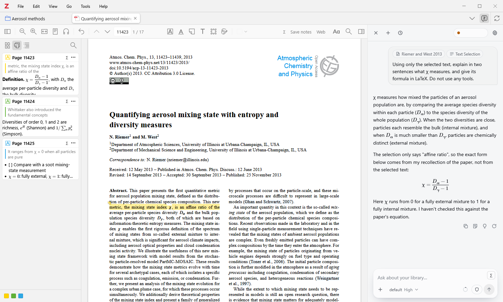
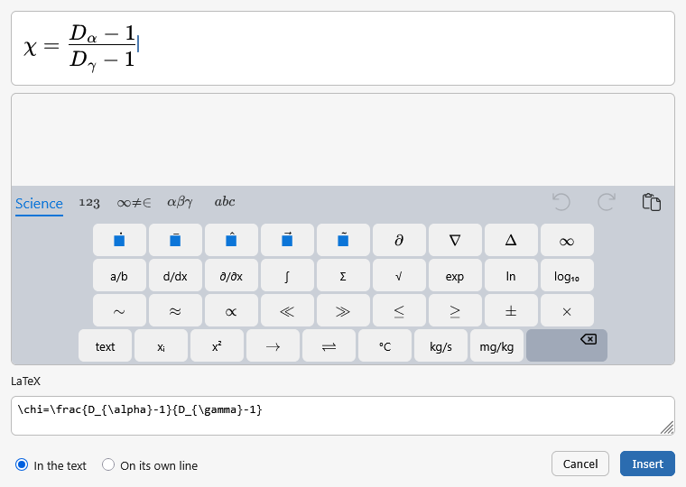
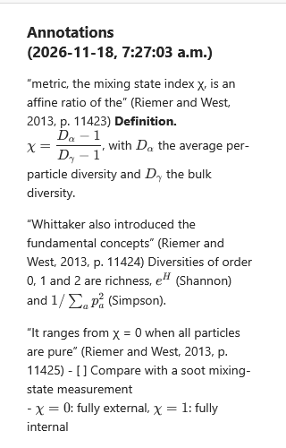
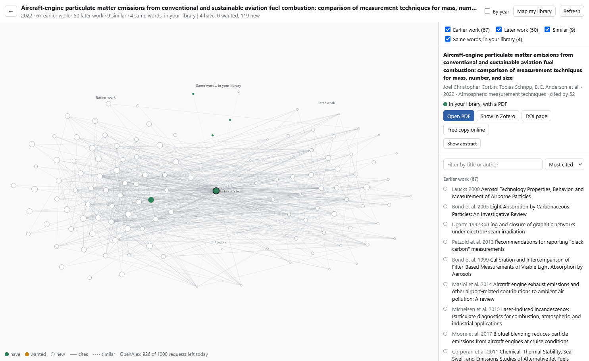
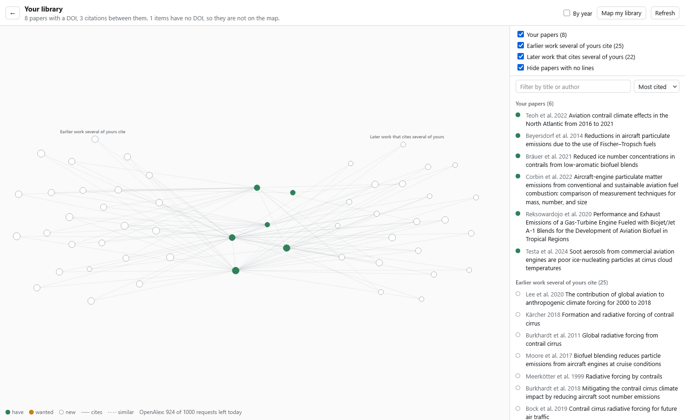
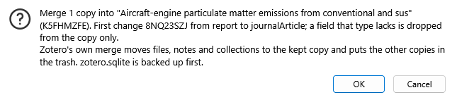

# Reading Room for Zotero

[](https://www.zotero.org)
[](plugin/manifest.json)
[](https://github.com/sidsharma2/reading-room-for-zotero/actions/workflows/tests.yml)
[](#install-on-a-mac)
[](LICENSE)

[](https://claude.com/claude-code)

Reading Room extends [Zotero](https://www.zotero.org), the free and open-source reference manager, with a set of plugins and scripts. Read papers in Zotero with a Claude or Codex chat beside the PDF. Ask about a passage or a figure, write comments in Markdown and LaTeX, build equations from a symbol keyboard, and save it all as notes under the paper. A connections web shows what a paper cites, what cites it and what is similar, and marks what you already have. Every question and answer can be kept word for word as a record.

Cloud models are the default, on your own Claude or ChatGPT sign-in, with no API keys. A second chat folder sends the same panel to a local model in Ollama or LM Studio.



This is a work in progress. I made it for myself, to make my life easier, and because I thought it would be fun and useful. I developed the plugins and scripts with [Claude Code](https://claude.com/claude-code), which wrote and tested much of the code under my direction.

I use it on Windows 11 with Zotero 10.0.8. The tests also run on macOS for every change, but the whole kit has not been used on a Mac yet. On a Mac, run `doctor` first and report what it prints.

## Features

- Chat beside the PDF. Select text or crop a figure, ask, and the answer comes back with rendered equations. Before each question, a hook finds the papers in your library, and the wiki pages if you keep a wiki, that match the question best, and hands the list to the agent.
- An equation editor with a symbol keyboard and a LaTeX box that stay in step. It inserts `$...$` into an annotation comment or the chat box.
- Markdown and LaTeX in annotation comments, and Save notes, which puts the paper's annotations and your questions and answers into a Zotero note.
- A connections web of earlier work, later work and similar papers from OpenAlex, with what you already hold marked. Map my library shows how your own papers cite each other.
- PDFs on every machine, through a folder your machines already sync, such as OneDrive, iCloud Drive or Google Drive.
- Library clean-up with a dry run first. File papers into topic collections from a CSV, merge duplicates from a list, delete imported keyword tags, and find missing DOIs. Each step shows every change before it writes, backs up `zotero.sqlite`, and logs what it did.
- Records of each question and answer, saved word for word in a hash chain, so a changed record shows.

## What is in it

| Part | What it does | Where it comes from |
|---|---|---|
| Zotero Agent 0.17.3 | The chat panel to the right of the PDF. Each question goes to Claude Code or Codex with the paper's title, page, selected text and any figure you crop. | `54yyyu/zotero-mcp`, downloaded by `plugins` and hash checked |
| Annotation Markdown 0.16.4 | Shows annotation comments as Markdown with rendered LaTeX, and turns todo lines into tags. | `qrkks/zotero-annotation-markdown`, downloaded the same way |
| Reading Room Tools 0.3.3 | The equation editor, the Save notes button, the connections web, the library plan, merge, tag and item-change steps, and wiki links that open in Obsidian. | `plugin/` in this repository |
| `related_sources.py` | Before each question, finds the papers and wiki pages that match it best and hands them to the agent. The answer ends with "Related in your library". | This repository |
| `qa_capture.py` | Saves each question and answer as Markdown records in a hash chain. | This repository |
| `papers.py` | Moves PDFs between machines, writes a library report, and looks up missing DOIs. | This repository |
| `reading_room.py` | Fetches the plugins, makes the chat folders, checks the machine, and syncs records and PDFs. | This repository |

## How it works

1. You open a PDF in Zotero and type a question in the panel. The panel starts Claude Code, or Codex, in its chat folder.
2. That folder's settings decide where the question goes. `~/ReadingRoom/chat` and the panel's default, `~/Documents/Zotero-Agent`, use your cloud sign-in. `~/ReadingRoom/chat-local` uses the local model.
3. A hook in the folder runs `related_sources.py`. It reads the question and the open paper, searches Reading Room Tools' copy of your library and your wiki if you have one, adds the paper's neighbours from the connections web, and gives the list to the agent. No model runs in this step.
4. The answer appears in the panel with rendered equations and links. A paper link opens it in Zotero. A wiki link opens the page in Obsidian.
5. Save notes on the reader toolbar puts the paper's annotations and your questions and answers in a Zotero note under the paper.
6. Web on the reader toolbar opens the connections web. When you open a paper, the plugin fetches its neighbours from OpenAlex in the background, so the agent has them by your first question.
7. `sync` saves new turns as records. If the capture folder is a clone of a private git repository, it pushes them there too, so another machine can collect them.

## Install on a Mac

You need Homebrew, and about 15 minutes.

1. Get the tools:

   ```bash
   brew install python@3.12 node uv git
   ```

2. Install Claude Code and sign in once. The panel uses this sign-in.

   ```bash
   curl -fsSL https://claude.ai/install.sh | bash
   ```

   ```bash
   claude auth login
   ```

3. Install `zotero-cli`, which the agent uses to read your library:

   ```bash
   uv tool install zotero-mcp-server==0.17.3
   ```

4. Get this repository:

   ```bash
   git clone https://github.com/sidsharma2/reading-room-for-zotero.git ~/Developer/reading-room-for-zotero
   ```

   ```bash
   cd ~/Developer/reading-room-for-zotero
   ```

5. Back up the Zotero data folder (`~/Zotero` unless you moved it), then update Zotero to version 10 from Help > Check for Updates or from zotero.org. The update changes the library database and cannot be undone.
6. Fetch the plugins. This downloads the two outside plugins, checks each against its pinned SHA-256, and builds Reading Room Tools:

   ```bash
   python3.12 reading_room.py plugins
   ```

7. In Zotero, open Tools > Plugins, click the gear icon, choose Install Plugin From File, and install each of the three files in `~/ReadingRoom/plugins`. Restart Zotero.
8. Make the chat folders. Run it again with the same flags whenever you change one.

   ```bash
   python3.12 reading_room.py setup
   ```

   Useful flags:
   - `--local lmstudio --model qwen/qwen3.5-9b` for LM Studio. The default is Ollama with `qwen3.5:4b`.
   - `--vault <wiki folder>` adds pages from a folder of Markdown notes, such as an Obsidian vault with a `wiki` folder, to the source list. Without it, the list still comes from your library and the connections web.
   - `--capture-remote <private git URL>` pushes records to a private repository. With none, they stay in `~/ReadingRoom/capture`.
   - `--papers-folder <shared folder>` turns on the PDF swap. See [PDFs on every machine](#pdfs-on-every-machine).
   - `--auto-read` lets read-only steps run with no approval card. See [Approvals](#approvals).

9. In Zotero settings, open Annotation Markdown. Turn on "Automatically add tags from todo directives" and turn off "Automatically preview image links".
10. Open a PDF and send one question while online. The first chat downloads the panel's agent bridge, and it cannot do that offline.
11. Check the machine:

    ```bash
    python3.12 reading_room.py doctor
    ```

12. To save records every 10 minutes, run this once. It adds a launchd job for your user, and `--remove` takes it away.

    ```bash
    python3.12 reading_room.py schedule
    ```

The panel finds `node` and `claude` itself. It reads your login shell's PATH, and it also looks in `/opt/homebrew/bin` and `~/.local/bin`. The scheduled job keeps the PATH of the terminal you ran `schedule` from, so it finds Homebrew's `git` too.

Some things are different on a Mac:

- A synced folder for `--papers-folder` lives under `~/Library/CloudStorage/` for OneDrive and Google Drive, and under `~/Library/Mobile Documents/com~apple~CloudDocs/` for iCloud Drive. A folder someone shared with you in OneDrive shows up there once you add a shortcut to it in OneDrive.
- macOS may ask once whether Zotero can use your Documents folder, because the panel's default chat folder is `~/Documents/Zotero-Agent`. Allow it, or point the panel at `~/ReadingRoom/chat`.
- macOS may stop a background job from reading a cloud folder. If `~/ReadingRoom/sync.log` or `papers.log` shows `Operation not permitted`, open System Settings > Privacy & Security > Full Disk Access and add the Python that the job runs, or run `papers.py swap` by hand.

## Install on Windows

1. Get the tools:

   ```powershell
   winget install Python.Python.3.12 OpenJS.NodeJS.LTS Git.Git astral-sh.uv
   ```

2. Install Claude Code and sign in:

   ```powershell
   irm https://claude.ai/install.ps1 | iex
   ```

   ```powershell
   claude auth login
   ```

   If you only have the Claude desktop app, run `py reading_room.py link-claude` after step 4 instead. It links the app's own CLI into `~\.local\bin`, and `doctor` tells you when the link falls behind the app.

3. Install `zotero-cli`:

   ```powershell
   uv tool install zotero-mcp-server==0.17.3
   ```

4. Clone this repository and go into it:

   ```powershell
   git clone https://github.com/sidsharma2/reading-room-for-zotero.git $HOME\Developer\reading-room-for-zotero
   ```

   ```powershell
   cd $HOME\Developer\reading-room-for-zotero
   ```

5. Follow Mac steps 5 to 12, with `py` in place of `python3.12`. On Windows, `schedule` adds a Task Scheduler task named "Reading Room sync".

## Use it

**Ask about a paper.** Open the PDF and use the Zotero Agent panel on the right. Select text or crop a figure first, and it goes in with the question. The answer can use LaTeX, and the panel renders it.

**Write an equation.** Press Σ, or Ctrl+Shift+M (Cmd+Shift+M on a Mac). Σ is on the reader toolbar, on each annotation and next to the chat box. The editor has a symbol keyboard, and the LaTeX source sits under the preview, so you can type in either one. Insert puts `$...$` at the cursor. From the toolbar with a comment open, it goes at the end of that comment.



**Annotate.** Write comments in Markdown with `$...$` math. Annotation Markdown renders them, as in the sidebar of the picture at the top.

**Save notes.** Click Save notes on the reader toolbar. It adds a note under the paper with the annotations and questions that are not in a note yet, tagged `reading-room`, with the equations and links kept. Earlier notes stay as they are, your edits included.



**Connections web.** Click Web on the reader toolbar, or right-click a paper and choose Show Connections Web. The paper sits in the middle with four groups around it: earlier work it cites on the left, later work that cites it on the right, papers OpenAlex rates as similar below, and papers in your library with many of the same words above. Lines also join papers that cite each other. Size shows how often a paper is cited, and colour shows what you hold (green have, amber wanted, hollow new).



- Click a paper for its details and buttons: Open PDF, Show in Zotero, Add to Zotero (by DOI, into My Library), Check later, DOI page, Free copy online. The abstract shows under them when OpenAlex has one.
- Expand, or a double-click, adds that paper's own 30 most cited neighbours to the web. Centre here makes it the middle paper, and the arrow at the top left goes back.
- By year lays the papers out on a timeline.
- The list on the right has the same papers, with a filter box and a sort.
- Map my library shows how your papers cite each other, the older papers that several of yours cite, and the newer papers that cite several of yours. Only items with a DOI can be placed.



The web uses OpenAlex, which is free and needs no sign-in. Without a key it allows about 1,000 requests a day, shared with everyone on your network. One paper takes about 4, and mapping a library of 450 items took about 20. Every answer is kept, with each paper's title, authors, year, venue, citation count, links and the first 1,200 characters of its abstract. A paper you have seen costs nothing for 30 days, and Refresh asks again. For more, get a free key at openalex.org/settings/api and paste it in Tools > OpenAlex Key for Connections. Nothing is added to your library unless you click Add to Zotero.

**Offline.** A web you have seen opens offline however old it is, and the status line says from which day. To have webs for papers you have not opened yet, Reading Room Tools fills the cache while Zotero is open and online: three minutes after Zotero starts and then every six hours, it fetches the webs of up to 25 papers in your library, the ones never fetched first. It stops at the first network failure, and when fewer than 250 of the day's OpenAlex requests are left, so your own clicks keep working. A library of 230 papers is filled in two or three days. To turn it off, set `extensions.rrtools.warmup` to `false` in Settings > Advanced > Config Editor.

**Check later.** Select a paper you do not have and click Check later. It goes into a list on this computer, `<Zotero profile>/reading-room/check-later.json`, with its details and abstract, so this works offline too. Check later at the top of the web, or Tools > Papers to Check Later, shows the list, marked against your library, with Add to Zotero on each paper and Add all to Zotero for every paper with a DOI. Those need the network. A paper leaves the list once it is in your library.

**Related sources.** Each answer ends with "Related in your library". Each source is marked:
- `in library` or `have`: the paper is in Zotero, with a file.
- `wanted`: Zotero knows the paper but has no file.
- `new`: the library does not have it.
- `wiki`: a wiki page.

The list comes from three places: the copy of your library that Reading Room Tools writes to `<Zotero profile>/reading-room/library.json`, the open paper's connections web, and your wiki if you gave `setup` a `--vault`.

The search matches words, so it can miss a source that says the same thing in other words. The agent reads each candidate and leaves out the ones that do not help.

**Cloud or local.** Set the panel's chat folder in its settings.

| To use | Chat folder | Needs |
|---|---|---|
| Claude or Codex on your plan | `~/Documents/Zotero-Agent` (the default) or `~/ReadingRoom/chat` | Sign-in and network |
| The local model | `~/ReadingRoom/chat-local` | The local server running |

For Codex, `setup` writes `.codex/config.toml` in each cloud folder. `zotero-cli` reads the library through Zotero's server on your own machine, and on a Mac Codex's default sandbox blocks that ("Operation not permitted"), so the file lets Codex use the network from that folder only. Codex's sandbox on Windows lets it through either way. It also sets medium reasoning effort, which answers reading questions faster than high. Codex reads such a file only in a trusted folder, so `setup` marks the folder trusted in `~/.codex/config.toml`.

For the local model, load it with at least 32,768 tokens of context. Panel turns measured up to 21,738 input tokens per call, and a smaller window can drop the start of the prompt with no error. In LM Studio, run `lms load qwen/qwen3.5-9b --context-length 32768` and then `lms server start --bind 127.0.0.1`. In Ollama, set `OLLAMA_CONTEXT_LENGTH=32768` and restart it. `doctor --ask` sends one real turn to the local model and times it.

Small models such as Gemma 4 E4B (`setup --local lmstudio --model gemma-4-e4b-it`) answer fast, but a local model has to read the whole prompt before its first word. Claude Code's tools, skills and plugins came to 24,078 tokens a call, 38 s on a Mac before Gemma said anything. So `chat-local` hides what a reading chat does not use: the web, task, plan, skill, Write and Edit tools, your plugins, your own MCP servers and your claude.ai connectors. That brings it to about 12,700 tokens. Read, Grep, Glob, Bash (for `zotero-cli`), the source hook and `CLAUDE.md` stay. LM Studio also reuses an unchanged prompt start, so a short answer then takes about 1 s and a library lookup with one tool call about 12 s. The cloud folders keep everything.

The claude.ai connectors (Gmail, Notion, alphaXiv and the rest) appear once Claude Code is signed in. With them a call went over 32,768 tokens and LM Studio refused every turn. Claude Code only skips them when told so before it starts, so `setup` asks it which connectors it has and denies each one in `chat-local`. Run `setup` again after you add a connector.

After a restart LM Studio may load the model with too little context. This loads it with 32,768 at each login, and does nothing when it is already loaded that way:

```bash
python3.12 reading_room.py autoload
```

On a Mac this is a launchd job. On Windows it is a small file, `Reading Room local model.cmd`, in your Startup folder, because a scheduled task that runs at login needs an administrator prompt. `local-ready` does the same once, by hand, and `autoload --remove` takes the login job or the file away.

On a machine with no Claude sign-in, the panel will not send, even in `chat-local`. Start Zotero with `python3.12 reading_room.py zotero` instead. That gives this one Zotero a placeholder token. Do not set the token for the whole machine, because it would override a real sign-in.

### Approvals

Each step the agent takes asks for your OK, and one question took about ten approvals. You can pick "Yes, during this session" on a card. Or run `setup --auto-read`, and a hook approves only these:
- reading the wiki and the paper's extracted text,
- read-only `zotero-cli` lookups (`search`, `read`, `outline`, `get`, `annotations list`), but not `annotations list --positions` or `--pdf-extraction`, which can download files,
- `grep`, `head`, `tail`, `cut`, `wc` and numbered `sed -n` on those files.

Everything else still asks, including any write, any other file, any network command and `zotero-cli config`, which can print settings that hold keys. It lets an agent skip a card, so it is off unless you ask for it. Run `setup` again without `--auto-read` to turn it off.

Use Claude Code or Codex in the panel. Zotero Agent also offers OpenCode and a custom agent, but neither runs Claude Code's hooks, so the source list and this approval hook do not apply to them, and OpenCode runs commands without asking unless its own settings say otherwise.

### Records

Records are the questions and answers word for word, with the model, time and paper. They are never edited, and `qa_capture.py verify` fails if one changes. `sync` saves new turns, checks them, and pushes them if the capture folder is a git clone. Keep that repository private, because it holds your questions, the answers and cropped figures.

On the machine that collects them, this imports them and refuses any machine whose records fail `verify`:

```bash
python3 qa_capture.py import --inbox <clone of the records repository>
```

## PDFs on every machine

Zotero syncs your items to every machine, but a PDF travels only through Zotero's file storage, and the free plan holds 300 MB. Once that is full, each machine keeps the PDFs it added, and the others see the item with no file. In one library of 226 PDFs, 146 had never left the machine that added them.

There are two fixes. Use the same one on every machine.

- **Zotero's paid file storage.** Zotero then moves every PDF itself, and you need nothing below.
- **A folder all your machines sync**, such as OneDrive, iCloud Drive or Google Drive. It costs nothing, and `papers.py` copies the PDFs through it. On every machine, open Zotero's Settings, then Account, and under File Syncing untick "Sync attachment files in My Library". Item sync stays on. Otherwise Zotero keeps trying to upload into the full storage and shows a red mark at each sync.

To use a shared folder, give it to `setup` on each machine, with the path OneDrive or iCloud gives it there:

```bash
python3.12 reading_room.py setup --papers-folder "<shared folder>"
```

From then on, each `sync` copies this machine's PDFs into the folder and takes the ones it lacks. On a machine whose questions are saved some other way, run only the PDF swap, every 30 minutes:

```bash
python3.12 reading_room.py schedule --papers-only
```

To swap once by hand:

```bash
python3.12 papers.py swap
```

`swap` is `share` then `fetch` with `--execute`. Each also runs on its own, as a dry run unless you add `--execute`.

Each PDF keeps the name Zotero gave it, so people can browse the folder, and a `README.md` there says what it is. Each machine lists what it put in the folder, with MD5s, in its own `manifest-<machine>.json`, so two machines never edit one file at once. `fetch` copies a file only when its MD5 matches, and only where Zotero has no file yet. Nothing is ever deleted from the folder, nothing writes to `zotero.sqlite`, and every copy is logged in `~/ReadingRoom/papers/placed.jsonl`. A OneDrive folder kept online-only works too, because `fetch` downloads each file as it reads it.

A publisher's licence usually covers you alone, so share the folder only with people who may have the papers.

**Copies already on the machine.** A missing PDF is often somewhere else on the disk, such as Downloads. This finds them and opens each one to check for the paper's DOI or title inside:

```bash
python3.12 papers.py find --in ~/Downloads --in "<another folder>"
```

It is a dry run, and it writes its plan to `~/ReadingRoom/papers/find-plan.json`. Add `--execute` to copy the checked ones. Copies that match only by file name are left alone, unless you check them and add `--include-name-only`.

`papers.py status` and `doctor` show how many PDFs this machine has.

## Organising the library

```bash
python3.12 papers.py tidy
```

This writes `~/ReadingRoom/papers/library-report.md`. It lists the collections with their sizes, the empty ones, and possible duplicates as links. It also counts PDFs on this machine and elsewhere, and how many tags are used only once. It changes nothing.

The four steps below each take a CSV, which you can write by hand or have an agent draft from the report. [`examples/`](examples/) has one of each. Every step shows what it would change and waits for your OK, then backs up `zotero.sqlite` in the Zotero data folder as `zotero.sqlite.before-reading-room-<step>.bak`, and writes a log to `<Zotero profile>/reading-room/`. Each run writes the same backup name, so copy a backup away first if you want to keep it.

**Applying a plan.** Tools > Apply Library Plan. A plan has a `key` column (the Zotero item key) and a `proposed topic` column. A row with only a `retire collection` names a collection, such as an old import folder, to move to Zotero's trash. Before anything is written it shows this:

```text
Create 3 collections: Topics, Topics / Soot measurement, Topics / Contrails and ice.
Add 3 items to 2 topic collections. Items stay in their other collections.
Move to the trash: Old import (3 items). The items stay in the library.
No item is deleted or changed. zotero.sqlite is backed up first.
```

It makes a Topics collection with one subcollection per topic, or uses a top-level collection that already has the topic's name. It adds each item to its topic and leaves it in its other collections. It moves the retired collections to the trash only if you tick the box. A collection in the trash can be restored, and its items stay in the library. It never deletes or changes an item. A row whose topic is "To sort by hand" is left alone, and running the same plan again changes nothing. Item sync then carries the new collections to your other machines.

**Merging duplicates from a list.** Tools > Merge Duplicates from a List takes a CSV with `key` and `merge into` columns. Zotero only merges items of one type, so a group with a copy of another type is refused, unless that copy's row says `yes` in an optional `change type` column. Then the copy takes the kept item's type before the merge. A field the new type does not have is dropped from the copy only, and the kept item's fields stay as they are.



It then uses Zotero's own merge, as the Duplicate Items view does: the kept copy gets the files, notes and collections, and the other copies go to the trash. A collection that is already in the trash is not added to the kept copy.

**Deleting imported keyword tags.** Tools > Delete Imported Keyword Tags deletes every tag that is only on papers, which is where publisher and Mendeley keywords end up. A tag on a note or an annotation, such as `reading-room` or a todo tag, stays, and so does any tag with a colour. It shows the count and the tags it keeps first, and logs every deleted tag with its papers.

**Finding missing DOIs.** This looks up every journal article that has no DOI:

```bash
python3.12 papers.py dois
```

It takes a DOI from the item's own link if one is there. Otherwise it searches Crossref, OpenAlex and DataCite by title. DataCite holds DOIs that Crossref does not, such as many university theses. A DOI is accepted only in three cases:

- the title is the same and so is the first author, with the years at most 3 apart, because a conference version and its journal version are often dated differently,
- the title is the same and the item names no author, with the years at most 2 apart,
- the title is nearly the same, or one title sits inside the other, such as "Review: ...", with the same first author and the years at most 1 apart.

Names are compared without accents, so Göing matches Goeing. A candidate whose authors do not include the item's first author is always refused.

It writes `~/ReadingRoom/papers/doi-lookup.csv`, with one action per item:

- `set doi` when a DOI was found,
- `trash` when nothing matched in all three services,
- `hold` when the item has a PDF, notes or annotations, or when a service did not answer.

A search that fails, for example because OpenAlex's free daily allowance is spent, never leads to `trash`. Run it again later to settle the held items. It keeps to Crossref's limit of one request a second, so it takes a few minutes.

**Applying item changes.** Tools > Apply Item Changes from a List, then pick that CSV. It shows every change first. It puts a DOI only into an empty DOI field of an item type that has one, moves the `trash` items to Zotero's trash, and leaves `hold` items alone. Zotero empties its trash after 30 days unless you change that in its settings.

## What leaves your machine

- Your questions, the selected text, cropped figures and the pages the agent reads go to the model you chose: your Claude or ChatGPT account, or the local model, which keeps them on the machine.
- The connections web sends OpenAlex the DOI of each paper you open, or its title when it has no DOI. Map my library sends the DOIs of all your papers. While Zotero is open and online, the warm-up sends those of up to 25 library papers every six hours, until it is turned off. `papers.py dois` sends titles to Crossref, OpenAlex and DataCite. None of these needs an account.
- Records stay in `~/ReadingRoom/capture` unless you set `--capture-remote`. PDFs go only to the folder you give `--papers-folder`.
- Nothing is sent to the author of this repository.

## Update

```bash
git pull
```

```bash
python3.12 reading_room.py plugins
```

If the Reading Room Tools version in `plugin/manifest.json` went up, install `~/ReadingRoom/plugins/reading-room-tools.xpi` again from Tools > Plugins and restart Zotero, because until then a window such as the connections web can still run the old code. Then run `setup` again with the flags you used before.

Zotero updates Zotero Agent and Annotation Markdown by itself while "Update Plugins Automatically" is on in Tools > Plugins. `zotero-cli` comes from the same project as Zotero Agent but stays at the version uv installed, so the two can drift apart. `doctor` shows each plugin's installed version and says when `zotero-cli` or Reading Room Tools needs updating.

## When something goes wrong

- Run `doctor`. Each line starting with `FIX` says what to do.
- The panel says it cannot find `node` or `claude`: restart Zotero after installing them. If it still fails, check that `which node` and `which claude` work in a new terminal.
- The cloud folder stopped answering: the Claude sign-in may have expired. Run `claude auth login`.
- A local answer ignores the start of the question: the model was loaded with too little context.
- The equation keyboard does nothing: install Reading Room Tools 0.1.1 or newer.

## Limits

- LM Studio with Gemma 4 E4B was tried on a Mac from the command line in `chat-local`, but not yet through the panel.
- Wiki pages in the source list need a copy of the wiki on the machine (`--vault`).
- The connections web knows only what OpenAlex knows. A paper with no DOI is placed only by an exact title, and OpenAlex has no abstract for many publishers' papers.
- Same words, in your library is a word match on titles, abstracts and tags. It finds papers on the same topic but can miss one that uses other words.
- The source list for Codex is written but not tested. Codex has no hook, so its `AGENTS.md` tells it to run the search itself.
- On a work computer, check first that your employer allows your library and a Claude sign-in there, and your papers in a shared folder.
- `papers.py find` checks a copy by the DOI or title stored as text in the PDF. A scanned PDF has neither, so it stays "not confirmed" until you check it.

## Files

| Path | What it is |
|---|---|
| `reading_room.py` | `plugins`, `setup`, `doctor`, `sync`, `schedule`, `link-claude`, `zotero` |
| `related_sources.py` | The source list hook, and the read-only approval hook |
| `papers.py` | PDFs on every machine (`status`, `share`, `fetch`, `swap`, `find`), the library report (`tidy`) and missing DOIs (`dois`) |
| `qa_capture.py` | Records: `capture`, `verify`, `import` |
| `research_annotation.md` | The record template |
| `plugin/` | Reading Room Tools source. `connections.js` fetches and builds the web, `content/web.*` draws it, `organise.js` applies plans and merges, and `build.py` makes the same `.xpi` on every machine |
| `examples/` | One CSV for each library step |
| `docs/images/` | The screenshots in this file |
| `.github/workflows/tests.yml` | Runs the tests on macOS and Windows for every change, and builds the plugin on both |
| `LICENSE` | The MIT licence |
| `test_*.py`, `plugin/test_*.mjs` | Tests: `python3.12 -m pytest` and `node --test plugin/test_tools.mjs plugin/test_connections.mjs plugin/test_organise.mjs` |

## Screenshots

The screenshots come from a separate demo library of open-access papers published under Creative Commons Attribution licences, including Riemer and West (2013), Atmos. Chem. Phys. 13, 11423-11439, CC BY 3.0, whose first page is shown, and Corbin et al. (2022), Atmos. Meas. Tech. 15, 3223-3242, CC BY 4.0. The highlights, comments and the question are examples written for the demo.

## Credits

Reading Room builds on other people's work:

- [Zotero Agent](https://github.com/54yyyu/zotero-mcp) by 54yyyu gives the chat panel and `zotero-cli`. The setup, hooks and records here are built around it.
- [Annotation Markdown](https://github.com/qrkks/zotero-annotation-markdown) by qrkks renders the Markdown and LaTeX in annotation comments.
- [llm-for-zotero](https://github.com/yilewang/llm-for-zotero) by yilewang and [seerai](https://github.com/dralkh/seerai) by dralkh are two other ways to chat with papers in Zotero. I compared both with Zotero Agent before choosing, and took ideas from them.
- [Research Rabbit](https://www.researchrabbit.ai) gave the idea for the connections web.
- [OpenAlex](https://openalex.org) supplies the citation data, Crossref and DataCite the DOIs, and [MathLive](https://github.com/arnog/mathlive) the equation editor.
- [Zotero](https://www.zotero.org) itself, and its plugin API.

## Licences

The code in this repository is under the MIT licence, in [`LICENSE`](LICENSE). Reading Room is an independent project. Zotero and the Corporation for Digital Scholarship do not make or endorse it.

Zotero Agent and Annotation Markdown are AGPL-3.0 and belong to their authors. `plugins` downloads them from their own releases, and they are not copied here. MathLive 0.111.4 (MIT, by Arno Gourdol) goes into Reading Room Tools at build time with its licence file, and `build.py` checks it against its npm integrity hash. Connection data comes from OpenAlex, whose data is CC0.
